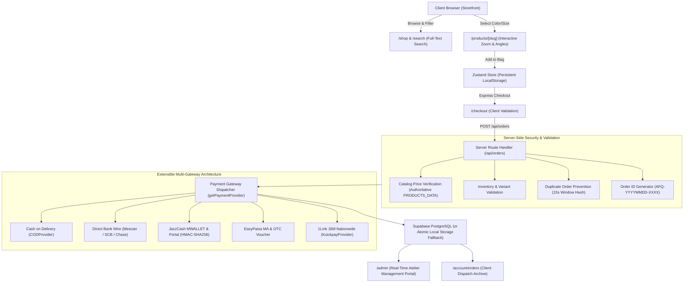

# AFAQ SUPPLY — Full E-Commerce Architecture & Payment Engine (Phase 4)

This document provides a comprehensive technical reference for the complete commercial and shopping architecture implemented in **Phase 4** for **AFAQ SUPPLY** (`THE ART OF EVERYDAY STYLE.`).

---

## 1. System Architecture & Flow Diagram

---

## 2. Customer Features & Experience

1. **Archival Search & Category Filtering (`/search`, `/shop`):**
   - Real-time client-side substring matching on titles, categories, tags, and garment descriptions.
   - Price range filtering, size filtering (XS to XL, EU 40 to 46), and sorting (Price Ascending, Price Descending, Newest Drop, Featured).

2. **Persistent Cart & Wishlist (`useCartStore`):**
   - Built on Zustand with `persist` middleware (`afaq-supply-cart-v1`).
   - Deeply integrated slide-out bag drawer, quantity modification, and item removal.
   - Wishlist toggle on all garments and sneakers, rendered in the Client Account portal.

3. **Customer Authentication & Account Portal (`/account`):**
   - Seamless 3-in-1 authentication tab:
     - **Client Sign In**: Email and password with Supabase Auth integration or local patron session.
     - **Create Patron Account**: Full name, email, phone, and secure password.
     - **Password Recovery**: Dispatches secure reset token with user confirmation notices.
   - **Profile Tab**: Editable personal details and membership tier badge (*Atelier Patron*).
   - **Saved Address Book**: Multi-address management with default badge and fast deletion/addition.
   - **Saved Silhouettes**: Direct bag re-addition from wishlist.

4. **Order History Archive (`/account/orders`):**
   - Chronological dispatches with live fulfillment status stepper:
     - `Order Confirmed` $\rightarrow$ `Atelier Assembly` $\rightarrow$ `In Transit` $\rightarrow$ `Delivered`.
   - Full silhouette breakdown: primary image, colorway, size, unit price, line subtotal, payment method, and destination address.

---

## 3. Server-Side Security & Order Validation (`/api/orders`)

Client browsers are considered untrusted environments. The server route handler at `src/app/api/orders/route.ts` enforces stringent commercial security rules:

1. **Price Verification:**
   - Incoming items are reconciled against the authoritative `PRODUCTS_DATA` catalog.
   - Any client that alters prices in local storage is immediately rejected with HTTP 400 (`Price discrepancy detected`).

2. **Idempotency & Duplicate Prevention:**
   - A cryptographic fingerprint (`email + item_ids + quantities + payment_method`) is cached in memory.
   - Resubmission within 15 seconds returns HTTP 429 (`A duplicate order was just submitted`).

3. **Authentic Order Sequencing:**
   - Generates production-standard order numbers: `AFQ-YYYYMMDD-XXXX` (e.g. `AFQ-20261114-8192`).

4. **Row Level Security (RLS):**
   - Supabase tables (`profiles`, `addresses`, `products`, `orders`, `order_items`, `payments`) have explicit RLS policies defined in `supabase/schema.sql`.
   - Service-role keys are never bundled into client distributions.

---

## 4. Multi-Gateway Payment Architecture

The payment system follows the open-closed principle via `IPaymentGatewayProvider` in `src/lib/payments/types.ts`:

### A. Cash on Delivery (COD)
- Available across Pakistan and international dispatch destinations.
- Configurable maximum threshold ($1,000 USD / PKR 280,000) for security.
- Status initialized as `PENDING_CUSTOMER_ACTION`.

### B. Direct Bank Wire (IBAN Remittance)
- Direct transfers to corporate accounts:
  - **Meezan Bank Ltd**: `PK72 MEZN 0002 8901 0588 9211`
  - **Standard Chartered Bank**: `PK44 SCBL 0000 0182 4492 8810`
  - **JPMorgan Chase Bank, N.A.**: `US48 CHPO 0001 2345 6789 01`
- Generates wire reference: `WIRE-AFQ-YYYYMMDD-XXXX`.

### C. JazzCash Mobile Wallet & 3D-Secure
- **Protocol**: SHA-256 HMAC calculated from sorted parameter keys + integrity salt.
- Supports `MWALLET` push to 03xx mobile devices and `MPAY` hosted redirect.
- **Production Guard**: When credentials are in sandbox/setup mode, generates an authentic Till remittance instruction (`Till #982104 — AFAQ SUPPLY ATELIER`) rather than simulating fake success.

### D. EasyPaisa Mobile Account & OTC
- Supports Direct Mobile Account debit and Over-The-Counter (OTC) 72-hour tokens.
- Corporate account: `0300-8849201`.

### E. 1Link / Kuickpay 1Bill Voucher
- Generates standard 18-digit 1Bill Consumer Number: `100492` + 12-digit order hash.
- Allows clients to settle invoices from ANY Pakistani commercial banking mobile app or ATM.

---

## 5. Atelier Admin Dashboard (`/admin`)

Protected management console featuring:

1. **Atelier Passcode Protection**: Security gate requiring authorization code (`1994`) for administrative access.
2. **Overview**: Real-time KPI cards for gross revenue, dispatch counter, active patron directory, and active silhouettes.
3. **Product Catalog CRUD**: Create new silhouettes with image previews, category mapping, and base pricing; instant deletion and live storefront preview.
4. **Live Inventory Control**: Unit counts per silhouette with low-stock warnings ($< 5$ units) and instant $+ / -$ adjustment counters.
5. **Orders Fulfillment Pipeline**: Live synchronized table displaying order reference, client contact, silhouettes ordered, total, and interactive status selector (`pending`, `confirmed`, `processing`, `shipped`, `delivered`, `cancelled`).
6. **Patron Directory**: Aggregates unique clients, order frequency, and lifetime value (LTV).
7. **Curated Collections**: Live link to custom lookbooks (`The Monochrome Archive`, `Footwear Foundations`).
8. **Store Settings & Announcements**: Dynamic announcement ticker banner and complimentary shipping threshold adjustment.
