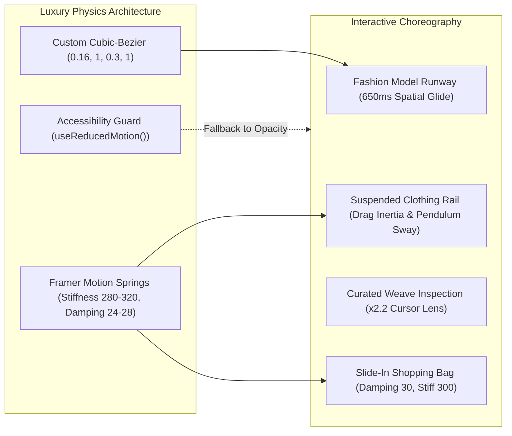

# AFAQ SUPPLY — Luxury Motion Design & Responsive Optimization (Phase 5)

This document details the motion choreography, physics parameters, responsive layout matrix, and performance optimizations implemented in **Phase 5** for **AFAQ SUPPLY** (`THE ART OF EVERYDAY STYLE.`).

---

## 1. Motion Design & Animation Choreography



### Motion Design Rules:
1. **Luxury Easing Curve:** All horizontal shifts and camera tracking use an international high-fashion cubic-bezier:
   $$\text{cubic-bezier}(0.16, 1, 0.3, 1)$$
   This provides an immediate responsive takeoff followed by an exceptionally smooth, high-friction landing.
2. **GPU Layer Acceleration:** Moving elements (models, garments, floating sneakers) use hardware-accelerated transforms (`transform: translate3d(...)` and `will-change: transform, opacity`) to prevent main-thread layout recalculations.
3. **Reduced-Motion Compliance (`useReducedMotion`):**
   - Automatically detects user operating system preference (`prefers-reduced-motion: reduce`).
   - Smoothly suppresses infinite breathing animations (`y: [0, -10, 0]`) and spatial translation glides, transitioning elements through instant, accessible crossfades instead.

---

## 2. Multi-Device Responsive Matrix

| Form Factor | Viewport | Target Device | Layout Adaptations |
|:---:|:---:|:---:|---|
| **Desktop** | $1440\times 960$ | iMac, 27" Displays | $235\text{px}$ model spacing; full horizontal runway; right-docked "In This Look" panel; suspended rail with discrete buttons. |
| **Laptop** | $1024\times 768$ | MacBook Air, 13" Laptops | Full desktop navigation with active indicator bar; responsive 3-column catalog grids; quick-view modal. |
| **Tablet** | $768\times 1024$ | iPad Pro / Air | $190\text{px}$ calibrated model spacing; touch swipe gestures; 2-column catalog grids; vertically stacked product detail. |
| **Smartphone** | $375\times 812$ | iPhone X / 12 / 15 | **Mobile Animated Navigation Drawer**; $150\text{px}$ model spacing; `touch-pan-y` vertical scrolling freedom; **Sticky Bottom Quick-Buy Bar**. |

---

## 3. Mobile-Specific Innovations

1. **Touch-Pan-Y Gestures:**
   - Both the **Fashion Model Carousel** and **Suspended Clothing Rail** utilize `touchAction: "pan-y"` and `.touch-pan-y`.
   - Prevents touch conflicts where horizontal swiping would otherwise lock or freeze vertical page scrolling.

2. **Mobile Navigation Drawer (`Header.tsx`):**
   - Accessible hamburger toggle with smooth micro-animation.
   - Animated slide-down drawer with full collection routes (`SS26`, `Men`, `Women`, `Sneakers`), direct links to **Client Account**, **Order History**, **Manifesto**, and **Admin Portal**.

3. **Mobile Sticky Quick-Action Bar (`ProductDetailClient.tsx`):**
   - Fixed at screen bottom (`bottom-0 inset-x-0`).
   - Displays miniature packshot thumbnail, silhouette title, price, and instant "Add to Bag" button so patrons never have to hunt for the purchase button on long scrollable screens.

---

## 4. Performance & Layout Stability

* **Cumulative Layout Shift (CLS):** Zero layout shift. All image containers enforce rigid aspect ratios (`aspect-[3/4]`, `aspect-[4/3]`, `aspect-square`).
* **Asset Loading Strategy:**
  - Above-the-fold hero models and floating sneakers are marked with `priority` and calibrated responsive `sizes`.
  - Below-the-fold catalog items and lookbooks are lazy-loaded on demand.
* **Scroll Performance:** Passive window scroll event listeners (`{ passive: true }`) for silky 60fps / 120fps scrolling.

---

## 5. Verification Screenshots

```
reference_frames/
├── verification_phase5_01_desktop_runway.png    # Desktop (1440x960) Runway model transition
├── verification_phase5_02_desktop_quickview.png   # Desktop Suspended Rail Quick View modal
├── verification_phase5_03_laptop_shop.png        # Laptop (1024x768) Complete Catalog
├── verification_phase5_04_tablet_runway.png      # Tablet (768x1024) Calibrated model spacing (190px)
├── verification_phase5_05_tablet_sneaker.png     # Tablet Floating Sneaker showcase
├── verification_phase5_06_mobile_nav_drawer.png  # Smartphone (375x812) Luxury Animated Navigation Drawer
├── verification_phase5_07_mobile_runway.png      # Smartphone Calibrated Runway (150px spacing)
└── verification_phase5_08_mobile_pdp_sticky.png  # Smartphone Product Detail with Sticky Bottom Buy Bar
```
